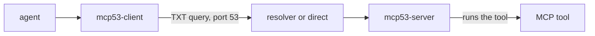

<p align="center">
  
</p>

<p align="center"><b>MCP tools reachable over DNS.</b> An agent whose tools work anywhere port 53 gets out.</p>

<p align="center">
  <a href="https://github.com/Crank-Git/mcport53/actions/workflows/ci.yml"></a>
  <a href="https://github.com/Crank-Git/mcport53/releases"></a>
  
  <a href="LICENSE"></a>
</p>

<p align="center">
  <a href="docs/PROTOCOL.md"><b>Docs</b></a> ·
  <a href="#install"><b>Install</b></a> ·
  <a href="#quick-start"><b>Quick start</b></a> ·
  <a href="https://github.com/Crank-Git/mcport53/releases"><b>Releases</b></a>
</p>



## Why mcport53

Captive portals and locked-down egress tend to block HTTP, websockets, and raw TCP, but
they almost always let DNS out. I wanted an agent's tools to keep working in those
places, so mcport53 carries MCP tool calls inside DNS queries and brings the results back
in TXT answers.

A call is a name: the JSON arguments are base32-encoded into labels, followed by the tool
name, `call`, a random nonce, and the zone (`<args>.<tool>.call.<nonce>.<zone>`). The
server is authoritative for that zone. It decodes the name, runs the tool, and answers
with a result envelope. Discovery is an SRV and a TXT record at `_mcp._udp.<zone>`.

The hard part was everything DNS doesn't want to do. A whole name is capped at 255 bytes,
so on `example.` a call carries about 134 bytes of arguments before the client has to
upload the rest in parts. Results bigger than a TXT answer come back in chunks, and slow
tools turn into jobs the client polls. Resolvers want to cache, so every call gets a
fresh nonce and every answer has TTL 0. And a QNAME-minimizing resolver walks down the
name label by label, so every name under the zone answers NOERROR instead of NXDOMAIN.

## Requirements

- **Go 1.27 or later**, only if you build from source.
- **A zone delegated to the server**, only for a real deployment through a resolver. Local
  runs talk to the server directly on `127.0.0.1:5333`.

## Install

Prebuilt `mcp53-server` and `mcp53-client` binaries for Linux, macOS, and Windows (amd64
and arm64) are attached to each [release](https://github.com/Crank-Git/mcport53/releases),
with a `SHA256SUMS` file:

```bash
curl -LO https://github.com/Crank-Git/mcport53/releases/download/v0.1.0/mcport53_v0.1.0_linux_amd64.tar.gz
tar -xzf mcport53_v0.1.0_linux_amd64.tar.gz
```

Or install from source:

```bash
go install github.com/Crank-Git/mcport53/cmd/mcp53-server@latest
go install github.com/Crank-Git/mcport53/cmd/mcp53-client@latest
```

## Quick start

Run the reference server. It serves three built-in tools (`add`, `echo`, `upper`) on
`127.0.0.1:5333`:

```bash
go run ./cmd/mcp53-server --zone example.
```

```
mcp53-server: listening on 127.0.0.1:5333 for zone example. (3 tools)
```

List the tools it serves:

```bash
go run ./cmd/mcp53-client --server 127.0.0.1:5333 --zone example.
```

```
version 1: 3 tool(s)

  add        Add two numbers and return their sum.
  echo       Return the supplied text unchanged.
  upper      Return the supplied text in uppercase.
```

Call one:

```bash
go run ./cmd/mcp53-client --server 127.0.0.1:5333 --zone example. --tool add --args '{"a":2,"b":40}'
```

```
{
  "content": [
    {
      "text": "42",
      "type": "text"
    }
  ]
}
```

The discovery document is plain DNS, so `dig @127.0.0.1 -p 5333 +short TXT
_mcp._udp.example.` shows the same tool list as JSON.

## Usage

The client and the server share most of their security flags:

| Flag | Side | What it does |
|---|---|---|
| `--key`, `--keys` | both | HMAC-sign each call with a default key, or per-tool keys as `tool=key,tool=key`. |
| `--verify-discovery` | client | Reject a discovery document that isn't signed with `--key`. |
| `--tsig name:secret` | both | Sign every query and response with TSIG. |
| `--tls-cert`, `--tls-key` / `--tls`, `--tls-ca` | server / client | Serve and query over DNS-over-TLS. |
| `--doh <url>` | client | Send every query to a DNS-over-HTTPS endpoint instead of `--server`. |
| `--discover host:port` | server | The SRV target advertised in discovery. Defaults to `--addr`. |

Every flag, with a worked example for each, is in [EXAMPLES.md](docs/EXAMPLES.md).

## Documentation

| Page | What's there |
|---|---|
| [PROTOCOL.md](docs/PROTOCOL.md) | Naming, argument encoding, the result envelope, chunking, job polling, caching, auth, and transport. |
| [DEPLOYMENT.md](docs/DEPLOYMENT.md) | Delegating a zone, private stub zones, and what works through a recursive resolver. |
| [EXAMPLES.md](docs/EXAMPLES.md) | End-to-end walkthroughs for the server and client, including signing, TSIG, DoT, and DoH. |
| [CONTRIBUTING.md](CONTRIBUTING.md) | Branch model, workflow, and conventions. |

## Development

```bash
go build ./...
go vet ./...
go mod tidy -diff
go test -race ./...
```

The resolver tests in `pkg/mcp/resolver_test.go` run a real Unbound in front of the
server. They skip if Unbound isn't installed; CI sets `MCP53_REQUIRE_UNBOUND=1` so they
can't.

## License

MIT. See [LICENSE](LICENSE).

---

<sub>Part of <a href="https://github.com/Crank-Git#things-over-port-53"><b>Things over port 53</b></a>,
my experiments in what else DNS can carry.
Siblings: <a href="https://github.com/Crank-Git/epochalypse">epochalypse</a> ·
<a href="https://github.com/Crank-Git/wingman">wingman</a> ·
<a href="https://github.com/Crank-Git/cachemoney">cachemoney</a> ·
<a href="https://github.com/Crank-Git/llamaoverdns">llamaoverdns</a> ·
<a href="https://github.com/Crank-Git/dnscalc">dnscalc</a> ·
Built by <a href="https://github.com/Crank-Git">Crank</a></sub>
